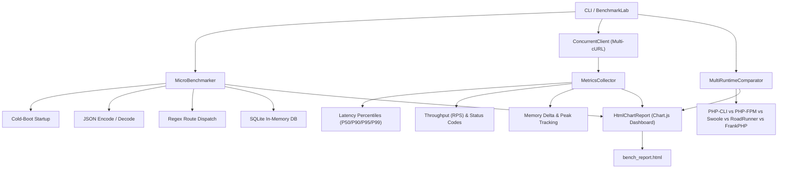

[🇸🇦 العربية](README.ar.md) | [🇬🇧 English](README.md)

# ⚡ eidcloud-php-bench

[](https://github.com/eidcloud/eidcloud-php-bench/releases)
[](https://php.net)
[](LICENSE)
[](https://colab.research.google.com/github/eidcloud/eidcloud-php-bench/blob/main/notebooks/quickstart.ipynb)

Objective PHP Runtime & Framework Benchmark Lab measuring throughput (RPS), cold-boot startup, latency percentiles, JSON serialization, SQLite throughput, and memory-per-request with interactive HTML Chart.js reports in pure PHP 8.2+ (Zero external vendor dependencies).

---

## 🚀 Key Capabilities

- **Pure PHP 8.2+ Zero-Vendor Engine**: Operates with native PHP standard library and built-in extensions (`curl`, `json`, `pdo_sqlite`). No `composer install` required to run benchmarks or reports.
- **Multi-Runtime Comparison**: Comprehensive benchmarking analysis covering:
  - **PHP-CLI**: Standard ephemeral single-process execution.
  - **PHP-FPM**: Battle-tested pre-forked FastCGI worker pool.
  - **RoadRunner**: Persistent worker IPC via high-concurrency Go supervisor.
  - **Swoole**: Coroutine CSP async non-blocking event loop.
  - **FrankPHP**: Embedded C-Go SAPI with native HTTP/3 and 103 Early Hints.
- **Concurrent Load Testing Client**: Non-blocking asynchronous load generation engine driven by `curl_multi_*` event loops, capturing exact percentile distributions (`Min`, `Avg`, `P50`, `P90`, `P95`, `P99`, `Max`).
- **In-Depth Micro-Benchmarks**:
  - Subprocess cold-boot initialization latency (ms).
  - Heavy nested JSON serialization and decoding ops/sec.
  - Dynamic regex parameter route matching latency.
  - In-memory SQLite transaction write and read throughput.
- **Standalone Interactive HTML Reports**: Generates zero-dependency responsive dark-mode HTML dashboards with embedded Chart.js visualizations.

---

## 🏗️ Architecture Workflow



---

## 📦 Installation

Ensure PHP 8.2 or higher is installed:

```bash
git clone https://github.com/eidcloud/eidcloud-php-bench.git
cd eidcloud-php-bench
```

*(Optional for library integration in other projects)*:
```bash
composer require eidcloud/php-bench
```

---

## 🛠️ Usage

### 1. Run Complete Benchmark Suite & Generate HTML Dashboard
```bash
php bin/eidcloud-php-bench run
```

### 2. High-Concurrency Live Target Load Test
```bash
php bin/eidcloud-php-bench run --target=http://localhost:8000 --concurrency=50 --requests=2000 --html=bench_report.html
```

### 3. Print Multi-Runtime Performance Matrix
```bash
php bin/eidcloud-php-bench compare
```

### 4. Re-generate HTML Report from Telemetry JSON
```bash
php bin/eidcloud-php-bench report --html=bench_report.html
```

### 5. CLI Help & Command Discovery
```bash
php bin/eidcloud-php-bench --help
```

---

## 🧪 Automated Testing

Zero-dependency test runner with 100% assertions pass rate:

```bash
php tests/run_tests.php
```

---

## 📊 Sample Output Preview

```text
=================================================================
  ⚡ EIDCLOUD-PHP-BENCH - Objective PHP Performance Harness
=================================================================
Initializing benchmark suite...
PHP Version: 8.2.12
Mode: Micro-benchmarks & Runtime Architectural Lab
-----------------------------------------------------------------

[1/4] Measuring PHP cold-boot startup time... Done (3.82 ms avg)
[2/4] Benchmarking JSON serialization & parsing throughput... Done (312,450 ops/s encode)
[3/4] Testing regex URL routing latency... Done (1,420,110 ops/s)
[4/4] Profiling SQLite in-memory database throughput... Done (42,500 inserts/s)

-----------------------------------------------------------------
✓ Benchmark Suite Finished Successfully!
📄 Interactive HTML Chart Report: bench_report.html
```

---

## 👨‍💻 Author & Maintainer

- **Eng. MHD. Shadi AL-Hasan**

---

## 📄 License

This project is open-sourced software licensed under the **[MIT License](LICENSE)**. Copyright (c) 2026 MHD. Shadi AL-Hasan.

---

## 👤 Author & Maintainer

**Eng. MHD. Shadi AL-Hasan**  
- **Role:** Executive CTO & Enterprise Solutions Architect  
- **Email:** [mhd.shadi.alhasan@gmail.com](mailto:mhd.shadi.alhasan@gmail.com)  
- **Phone / WhatsApp:** [+963934005922](tel:+963934005922)  
- **Location:** Damascus, Syria  
- **GitHub:** [shadialhasan](https://github.com/shadialhasan)  

---

## 📄 License

This project is licensed under the MIT License - see the [LICENSE](LICENSE) file for details.  
Copyright (c) 2026 **MHD. Shadi AL-Hasan**. All rights reserved.
